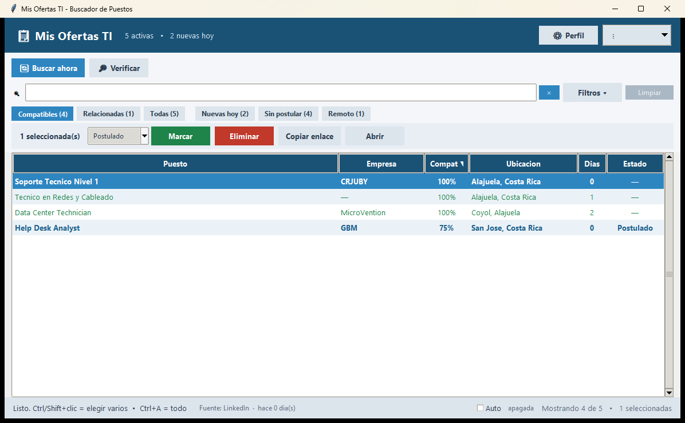
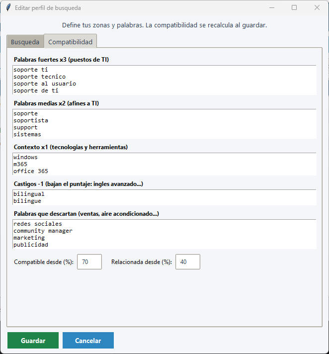

# Buscador de Puestos — Soporte TI / Redes

[](https://github.com/MREmmanuel09/BucadorDePuestos/actions/workflows/ci.yml)
[](LICENSE)
[](https://www.python.org/)

Herramienta de escritorio en Python (solo biblioteca estandar) que busca ofertas de
trabajo en **Computrabajo, Trabajo.org, FindJob24h y LinkedIn**, las clasifica por
**enfoque real del puesto** (Soporte, Redes, Infraestructura, Campo, Aplicaciones o
Seguridad), les asigna un **puntaje de compatibilidad (0-100 %)** según tu perfil y te
ayuda a postular todos los días sin perder el seguimiento.

## Funciones

- **Aplicacion de escritorio** (Tkinter) con jerarquia clara: **Buscar ahora** y
  **Verificar** como acciones principales; el resto vive en el menu `⋮` o aparece
  solo al seleccionar ofertas.
- **Enfoque del puesto, no solo palabras**: una oferta debe tener un ancla real de TI
  en el titulo (`soporte`, `redes`, `help desk`, `NOC`, `infraestructura`, `data
  center`...). Asi no entran "Senior Software Engineer", "Tecnologo de Alimentos" ni
  "Soporte de Aire Acondicionado" solo porque compartan una palabra.
- **Familias de puesto**: cada oferta se etiqueta como *Soporte*, *Redes*,
  *Infraestructura*, *Campo*, *Aplicaciones*, *Seguridad* u *Otro TI*. La tabla trae
  una columna **Enfoque** y el panel de filtros permite elegir una o varias.
- **Catalogo amplio con rotacion diaria**: 27 consultas (espanol e ingles) y una
  ventana de 16 por corrida; las 8 esenciales siempre corren y el resto rota dia a
  dia. En *Preferencias* puedes subir el limite o poner `0` para usar todas.
- **Meta diaria de postulaciones**: el encabezado muestra `Hoy 2/5 postuladas` y
  *Preferencias* permite cambiar la meta. Se calcula con los eventos del historial.
- **Fuentes mas profundas**: Trabajo.org recorre hasta 8 paginas por zona y guarda la
  ubicacion real; FindJob24h usa su buscador (antes leia solo la portada) y abre
  titulo, empresa y ubicacion sin descargar cada detalle.
- **Filtros utiles**: busqueda con debounce, chips de *Compatibles*, *Relacionadas*,
  *Todas*, *Nuevas hoy*, *Sin postular* y *Remoto*, panel de filtros por fuente,
  zona, estado y enfoque, y encabezados ordenables.
- **Barra contextual**: al seleccionar ofertas aparecen *Marcar*, *Eliminar*,
  *Copiar enlace* y *Abrir*; no ocupan espacio cuando no hacen falta.
- **Menu de mantenimiento**: verificar disponibilidad, lista negra, depurar
  incompatibles, estadisticas (incluye reparto por enfoque), preferencias y atajos.
- **Puntaje de compatibilidad**: palabras fuertes x3, medias x2, contexto x1 y castigos
  -1 sobre el **titulo**; **Compatible** (70 %+), **Relacionada** (40-69 %) o
  **Descartada** (no entra; se limpia desde el menu). Los puestos senior se muestran
  como Relacionadas para no competir con vacantes junior/mid. Umbrales editables.
- **Filtro inteligente**: zonas, modo remoto, palabras que acepta/descarta,
  exclusiones por rubro (ventas, aire acondicionado, salud, desarrollo...) y sectores
  mixtos: "Tecnico de Cableado Estructurado y Obra Civil" sigue siendo Redes, pero
  "Soporte para Aire Acondicionado" queda fuera.
- **Lista negra configurable**: lo que eliminas no vuelve a aparecer en ese plazo.
- **Deteccion de ofertas cerradas**: solo con evidencia positiva (fecha vencida,
  pagina 404/410, mensaje "ya no se aceptan solicitudes"...); un error de red
  **nunca** borra nada.
- **Datos protegidos**: escrituras atomicas, bloqueo entre la app y la tarea
  programada, backups rotativos y clave SMTP cifrada con DPAPI de Windows.
- **Busqueda automatica diaria** opcional con el Programador de tareas de Windows,
  notificaciones de Windows y reporte HTML de solo lectura (con columna de enfoque).

## Requisitos

- Windows y **Python 3.10+** de https://www.python.org/ (marca *Add python.exe to PATH*).
- Sin dependencias externas: no hay que instalar nada con pip.

## Primeros pasos

1. Clona o descarga el repositorio.
2. Doble clic en **`Abrir Ofertas.cmd`** (o icono del escritorio si lo creas).
3. Pulsa **Editar perfil** y pon tus zonas y palabras. La pestana **Enfoques** tiene
   las anclas de puesto que aceptas (soporte, redes, infraestructura...).
4. Pulsa **Buscar ahora**.
5. En **Preferencias** ajusta la **meta diaria** y las **consultas por corrida**.

### Como sacar mas opciones cada dia

- **Sube las consultas por corrida**: en *Preferencias* pon `0` para usar las 27, o un
  valor entre 20 y 24. Tardara mas, pero cubre mas vocabulario y fuentes.
- **Revisa la pestana Enfoques**: si un puesto que si te interesa queda fuera, agrega
  su palabra al ancla (por ejemplo `noc`, `field service`, `soporte de aplicaciones`).
- **Ajusta las palabras que descartan**: la lista nueva ya excluye desarrollo de
  software, ventas, salud, electromecanica y atencion al cliente. Si quieres volver a
  ver alguno, quita la frase.
- **Amplia zonas solo si el transporte lo permite**: agregar Heredia o distritos del
  GAM destraba muchas ofertas de LinkedIn; el sistema no lo hace por ti.
- **Corre la busqueda a diario**: la rotacion de consultas esta pensada para que en
  una semana se cubra todo el catalogo sin repetir siempre lo mismo.
- **Postula desde Compatibles y luego Relacionadas**: la columna **Enfoque** y el
  filtro del mismo nombre te dejan armar una lista corta por tipo de puesto.

En el primer arranque se crea `buscador/config.json` a partir de
`buscador/config.example.json`. Ese archivo es **tu copia local** y esta ignorado
por Git (junto con `buscador/data/`, donde quedan tus ofertas, lista negra e historial).

## Capturas

**Aplicacion principal** — chips de filtro, encabezados ordenables, barra contextual
al seleccionar una oferta y el detalle de fuente/antiguedad en el pie:



**Editar perfil** — pestañas *Búsqueda* (zonas, términos, remoto) y *Compatibilidad*
(grupos de palabras por peso, palabras que descartan y umbrales; así se ve la segunda):



## Estructura

Todo el codigo esta documentado en espanol (docstring en cada funcion) y la guia
completa de como funciona esta en **[MAPA_DEL_CODIGO.md](MAPA_DEL_CODIGO.md)**.

```
buscador/
  app.pyw            # aplicacion de escritorio (interfaz principal)
  main.py            # busqueda, filtros, lista negra, meta diaria, reporte
  compatibilidad.py  # puntaje 0-100 %, ancla y categoria de cada oferta
  puestos.py         # enfoque TI, familias y naturaleza del puesto
  consultas.py       # catalogo de consultas con rotacion diaria
  verificar.py       # deteccion de ofertas cerradas (evidencia positiva)
  eliminar.py        # borrado por terminal (avanzado)
  almacen.py         # escrituras atomicas, backups y lectura segura
  bloqueo.py         # bloqueo entre la app y la tarea programada
  secretos.py        # cifrado DPAPI de la clave SMTP
  config.example.json# plantilla de configuracion (versionada)
  fuentes/           # conectores: computrabajo, trabajo_org, findjob24h, linkedin
  data/              # datos locales (ignorado por Git)
docs/                # capturas de la aplicacion
tests/               # pruebas unitarias (unittest)
.github/workflows/   # integracion continua (CI)
pyproject.toml       # metadatos y herramientas de desarrollo
```

## Aviso

Uso personal: las fuentes se consultan publicamente con pausas entre solicitudes y
pueden cambiar sin aviso. Respeta los terminos de uso de cada sitio.

## Licencia

Distribuido bajo la licencia **MIT** — ver [LICENSE](LICENSE). Puedes usarlo,
modificarlo y compartirlo libremente (incluso con fines comerciales), conservando
el aviso de copyright.
